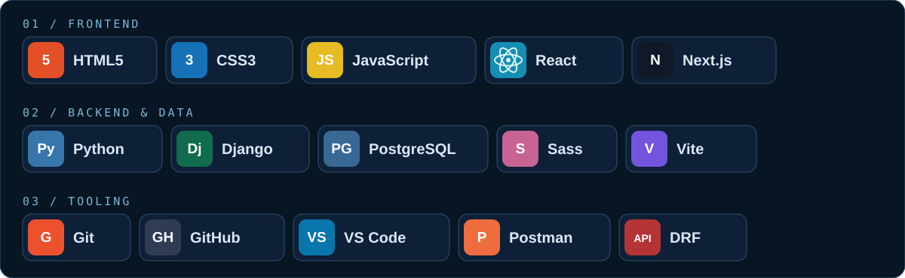

### Fullstack Developer · AI Specialist

## `01 // TECH ARSENAL`

  

## `02 // AI EXPERTISE`

  

I use **LLMs and AI development tools** as part of the engineering workflow — from breaking down requirements and exploring architectures to debugging, reviewing changes, and automating repetitive work. My focus is on **prompt engineering, context management, and verifying model output** rather than accepting generated code without understanding it.

**Tools:** ChatGPT · Codex · Gemini  
**Applied to:** React / Next.js interfaces · Django REST APIs · PostgreSQL-backed applications

## `03 // DEVELOPMENT`

| Frontend | Backend | Engineering workflow |
| :--- | :--- | :--- |
| React, Next.js, JavaScript | Python, Django, DRF | Git, APIs, debugging |
| UI components, state, responsive layouts | Authentication, data models, REST endpoints | Planning, testing, AI-assisted iteration |

## `04 // CONNECT`

**[GitHub](https://github.com/count-rzy)** · **[Repositories](https://github.com/count-rzy?tab=repositories)** · **[Telegram](https://t.me/count_rzy)**

