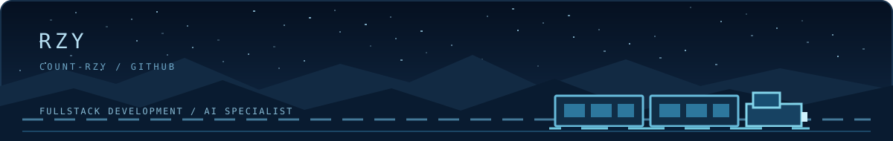

 

**`FULLSTACK DEVELOPER`** &nbsp; / &nbsp; **`AI SPECIALIST`**

## `01 // TECH ARSENAL`

**FRONTEND**

**BACKEND & DATA**

**WORKFLOW**

## `02 // AI EXPERTISE`

I work with **LLMs and AI-powered development tools** for practical tasks: turning requirements into structured plans, exploring solutions, debugging code, reviewing implementations, and accelerating repetitive workflows. I focus on **prompt design, context management, checking outputs, and understanding the generated code** rather than trusting it blindly.

<table>
<tr>
<td width="50%" valign="top">

**`AI / APPLICATION`**

- Prompt engineering and iteration
- AI-assisted coding and debugging
- Research, synthesis and technical explanations
- Workflow improvement and automation

</td>
<td width="50%" valign="top">

**`ENGINEERING / PRACTICE`**

- React interfaces and component architecture
- Django REST APIs and authentication
- PostgreSQL and data modeling
- Git workflows, testing and troubleshooting

</td>
</tr>
</table>

## `03 // DEVELOPMENT FOCUS`

<table>
<tr>
<td width="33%" valign="top">

**`FRONTEND`**

React · Next.js · JavaScript

Reusable components, state, responsive UI and user interactions.

</td>
<td width="33%" valign="top">

**`BACKEND`**

Python · Django · DRF

APIs, authentication, business logic and reliable data flow.

</td>
<td width="33%" valign="top">

**`AI WORKFLOW`**

LLMs · Prompting · Codex

Specification, prototyping, code review and verification.

</td>
</tr>
</table>

## `04 // GITHUB`

## `05 // LINKS`

 

