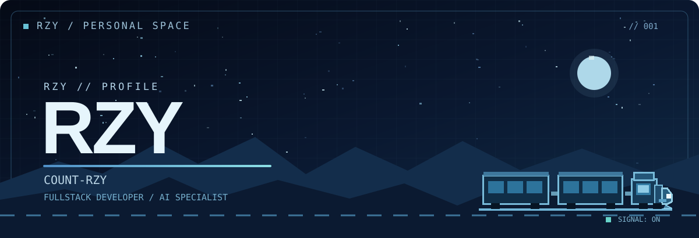
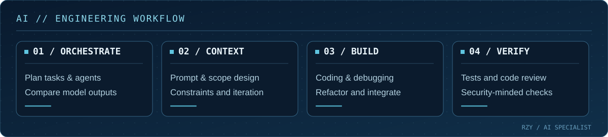

### Fullstack Developer · AI Specialist

## `01 // TECH ARSENAL`

**Frontend**

 &nbsp;  &nbsp;  &nbsp;  &nbsp;  &nbsp;  &nbsp;  &nbsp; 

**Backend & Data**

 &nbsp;  &nbsp;  &nbsp; 

**Tools**

 &nbsp;  &nbsp;  &nbsp;  &nbsp;  &nbsp;  &nbsp; 

## `02 // AI TOOLS`

 &nbsp;  &nbsp;  &nbsp;  &nbsp;  &nbsp;  &nbsp;  &nbsp;  &nbsp;  &nbsp; 

## `03 // AI EXPERTISE`

I work with **multiple AI models and coding agents** throughout the development process: exploring approaches, breaking down requirements, structuring prompts and context, implementing features, debugging, and reviewing code. I focus on **reasoning about the output, verifying assumptions, and keeping control of the final implementation**.

**AI-assisted engineering:** structured prompting · context management · model comparison · agent workflows · code review · test planning · security-minded verification · workflow automation

**Applied to:** React / Next.js interfaces · Django REST APIs · authentication · PostgreSQL-backed applications

## `04 // DEVELOPMENT`

| Frontend | Backend | Engineering workflow |
| :--- | :--- | :--- |
| React, Next.js, JavaScript | Python, Django, DRF | Git, APIs, debugging |
| UI components, state, responsive layouts | Authentication, data models, REST endpoints | Planning, testing, AI-assisted iteration |

## `05 // CONNECT`

**[GitHub](https://github.com/count-rzy)** · **[Repositories](https://github.com/count-rzy?tab=repositories)** · **[Telegram](https://t.me/count_rzy)**

