### Fullstack developer in progress

Based in Yerevan, Armenia &nbsp;·&nbsp; English B2 &nbsp;·&nbsp; Curious by default

  

 

### `01 / ABOUT`

I'm **Suren**, a developer focused on learning how complete web applications work — from interfaces and user experience to APIs and databases.

I enjoy problem-solving, clean structure, and turning ideas into something functional. I'm still improving my skills, one step at a time.

### `02 / TOOLKIT`

### `03 / ACTIVITY`

Real commits, real progress. GitHub's native contribution graph lives right below this README.

### `04 / CONNECT`

[**GitHub**](https://github.com/count-rzy) · [**Telegram**](https://t.me/count_rzy)

 

Designed for a little less noise and a little more personality.

